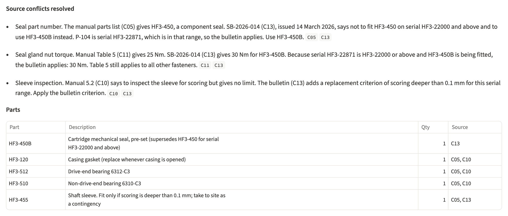
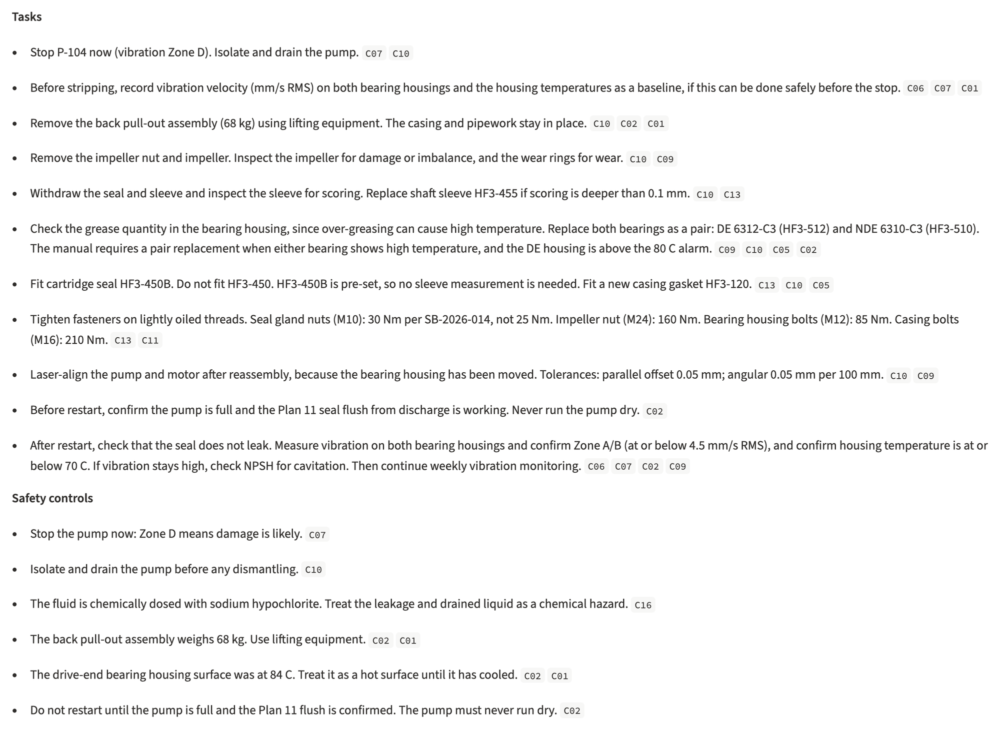
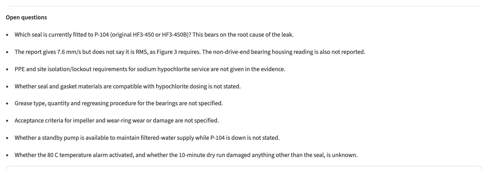
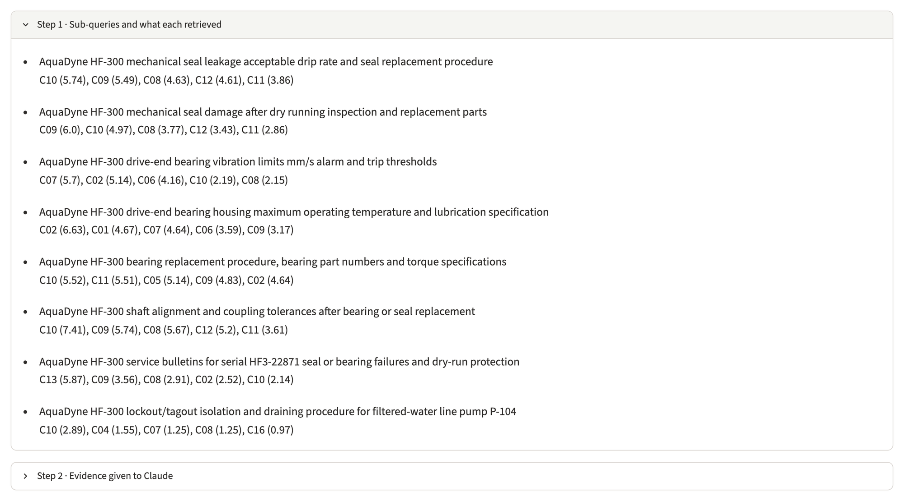
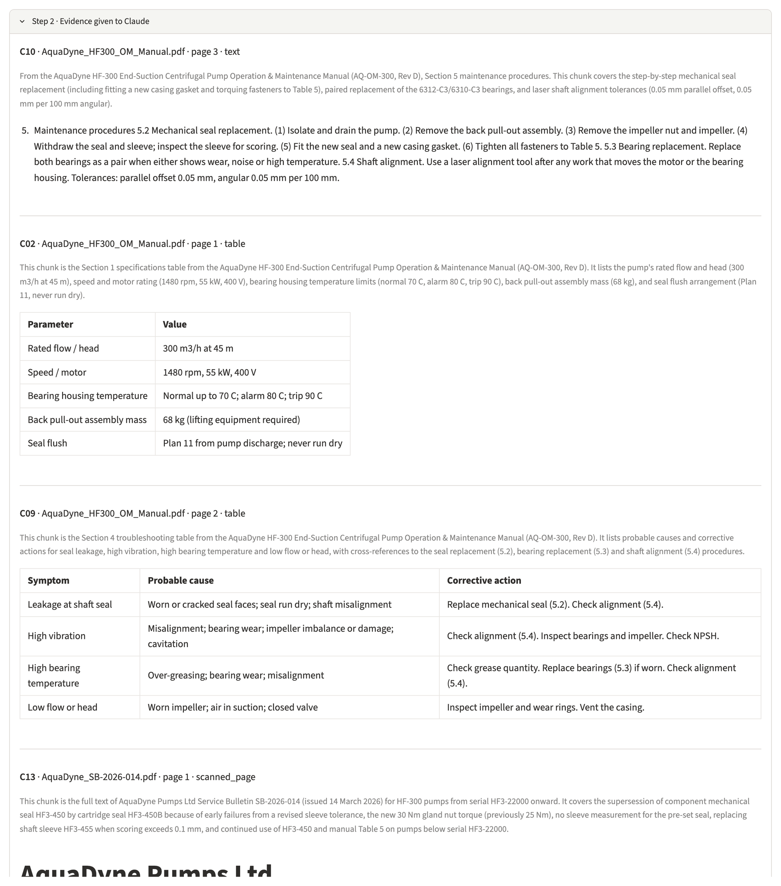
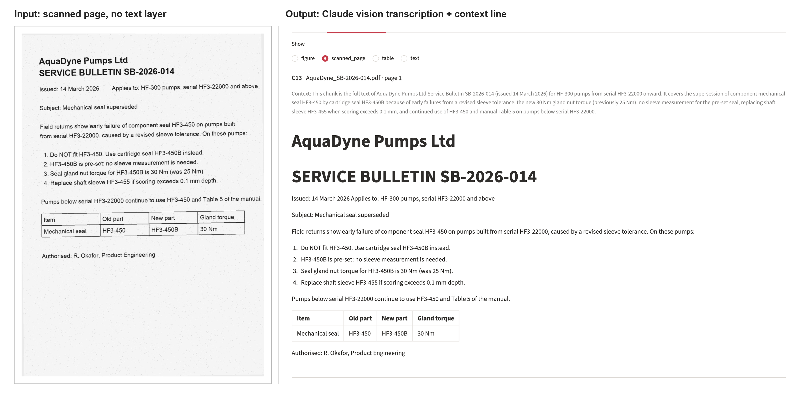

# Fault report → work order (RAG with Claude)

A technician reports a fault. The app reads the equipment manual, a scanned service bulletin and
the site's safety procedure, then produces a **structured work order**: condition vs. limits,
probable causes, ordered tasks with torques, part numbers, safety controls and labour, where
**every line cites the evidence** and the citations are checked in code.

RAG here solves a planning problem; it is not a chat box. The answer needs facts from three
documents, one of which overrides another.

## The sample problem

> Pump P-104 (AquaDyne HF-300, serial HF3-22871). Water dripping from the shaft, vibration
> 7.6 mm/s at the drive-end bearing, bearing housing 84 C, pump ran dry last week.

A correct work order has to:

| Fact | Where it lives | Why it's hard |
|---|---|---|
| 7.6 mm/s is Zone D → stop the pump | Chart in manual (Fig. 3) + site rule | Limits exist **only in the image** |
| 84 C is above the 80 C alarm → priority 1 | Spec table + site rule | Two documents |
| Seal is **HF3-450B**, not HF3-450 | Scanned bulletin overrides manual parts list | **No text layer**; sources conflict |
| Gland nut torque **30 Nm**, not 25 Nm | Scanned bulletin overrides manual Table 5 | Same conflict, serial-dependent |
| Lifting plan required | 68 kg assembly (manual) vs 25 kg limit (site) | Multi-hop across documents |
| Chemical goggles and gloves | P-104 is on a dosed line (site doc) | Only in a footnote sentence |

The documents are synthetic (generated by `make_sample_docs.py`), so there is no confidential or
copyrighted data. They are built to have ruled tables, an exploded-view drawing, a chart and
a skewed, noisy scan.

## Walkthrough (real run, Claude Opus 5.5)

### 1. The result: a prioritised, cited work order

The technician's free-text report goes in. The output says **P1, stop the pump now**, and every
reading is compared with its documented limit. The grey tags (`C07`, `C02`...) are the evidence
chunks behind each statement. The green tick means the code checked every citation (38 items,
0 unknown IDs, 0 uncited items).


### 2. Conflicting sources, resolved explicitly

The manual says seal **HF3-450** at **25 Nm**. A later scanned bulletin says serial HF3-22000 and
above must use **HF3-450B** at **30 Nm**. The planner checks the serial (HF3-22871), picks the
bulletin, and **shows its reasoning** under `source_conflicts`. The parts list follows from that
decision.



### 3. Ordered tasks with torques, plus site safety controls

Facts from three documents end up in one plan: the procedure and torques from the manual, the
30 Nm override from the bulletin, and the 68 kg lift and hypochlorite dosing from the site safety
procedure.



### 4. It says what it doesn't know

The model is told not to guess, so gaps in the evidence become open questions, for example
"was 7.6 mm/s measured as RMS?" or "which grease and how much?".



### 5. Under the hood: query decomposition and hybrid retrieval

Claude turns one report into 6–8 targeted queries. Each query runs BM25 + dense search, fused
with RRF and reranked by a cross-encoder. The numbers are reranker scores. Note that only the
serial-number query surfaces `C13`, the scanned bulletin.





### 6. Parsing what plain text extraction misses

**A scan with no text layer.** Claude vision transcribes it to Markdown, including the table.
Contextual retrieval then adds the grey "Context" line, so it can be found by meaning.



**A chart whose limits exist only as pixels.** Zone boundaries 2.8 / 4.5 / 7.1 mm/s are not in
the PDF's text. The figure is cropped and transcribed into a searchable table, which is how
"7.6 mm/s → Zone D → stop" becomes answerable.


The full CLI output of a run is in [`examples/sample_run.txt`](examples/sample_run.txt).

> **On determinism:** the CLI and UI runs above are two separate LLM runs. Both got the critical
> facts right, but wording and minor items differ between runs. For example, one run listed
> "chemical goggles and nitrile gloves" explicitly while another said "treat as a chemical
> hazard". The [evaluation](#evaluation) below measures this, traces it to a retrieval bug, and
> measures the fix.

## Pipeline

```
INGEST (offline, once)                                 SOLVE (per fault report)
PDF ──► route each page element                        fault report
        ├─ digital text  → PyMuPDF blocks                  │
        ├─ ruled tables  → PyMuPDF table → Markdown        ▼
        ├─ figures       → crop → Claude vision        1. Claude decomposes it into 4–8 queries
        └─ scanned page  → Claude vision                   │  (structured output)
        ▼                                                  ▼
   structure-aware chunks (tables/figures never split)  2. each query: BM25 + dense → RRF
        ▼                                                  → cross-encoder rerank → merge
   contextual retrieval: Claude writes a context line      │
   per chunk (whole doc as cached prefix)                  ▼
        ▼                                              3. Claude writes WorkOrder (Pydantic
   BM25 index + bge-small embeddings                      schema), every item cites chunk IDs
                                                           ▼
                                                       4. code verifies every citation
```

## Techniques and why each one is here

1. **Hybrid, routed parsing** (`rag/parsing.py`). Each element goes to the cheapest reader that
   works. Digital text and ruled tables are extracted exactly and for free. Claude vision is used
   only where pixels carry the meaning: the chart, the drawing and the scan. Captions are attached
   to their table or figure, and reading order is kept. Sending every page to a VLM would cost more
   and risk misreading text that is already exact.
2. **Structure-aware chunking** (`rag/chunking.py`). Tables, figures and scans are atomic chunks.
   Half a torque table is how RAG quotes the wrong bolt.
3. **Contextual retrieval** (Anthropic, 2024). Before embedding, Claude writes one or two
   sentences situating each chunk in its document. A bare table row like "M10 | 25" becomes findable
   as "seal gland nut torque for the HF-300". The full document is sent as a cached prefix.
4. **Hybrid search with RRF, then reranking** (`rag/retrieval.py`). BM25 catches exact tokens
   such as `HF3-450B`, `M10` and `7.1`, which embeddings blur. Dense search catches paraphrase:
   "water dripping from the shaft" finds "leakage at shaft seal". Reciprocal Rank Fusion merges the
   two rankings without calibrating scores, and a cross-encoder reranks the fused candidates.
5. **Query decomposition** (`rag/workorder.py`). One fault report becomes several targeted
   lookups, covering limits, causes, procedure, parts, torques, labour and site safety. Results are
   merged by rank, round-robin, because reranker scores aren't comparable across queries. Both
   changes came from the eval below.
6. **Grounded structured output with verification**. `messages.parse` with a Pydantic `WorkOrder`
   schema, a citation on every item, and a code-side check that every cited ID was actually supplied.
   Conflicts between sources must be resolved explicitly in `source_conflicts`.

LLM calls go through `rag/llm.py`. By default that is `claude-opus-5-5`, with adaptive thinking,
an effort level per step, and server-side refusal fallback enabled. Set `APP_MODEL` to any other
model ID to use an open-weight model through Doubleword's OpenAI-compatible API (key in `.env`).

## Run it

```bash
export ANTHROPIC_API_KEY=...          # your key
uv sync
uv run python make_sample_docs.py     # writes docs/*.pdf (already included)
uv run python ingest.py               # parse, chunk, contextualise, embed → data/
uv run python solve.py                # CLI run on the sample fault
uv run streamlit run app.py           # UI: work order + every intermediate step
```

The first run downloads two small local models (embedder and reranker, about 200 MB in total).

## Files

| File | What it does |
|---|---|
| `rag/parsing.py` | Routed PDF parsing: text, tables, figures, scans |
| `rag/chunking.py` | Structure-aware chunks and contextual retrieval |
| `rag/retrieval.py` | BM25 + dense + RRF + rerank |
| `rag/workorder.py` | Decompose → retrieve → plan → verify citations |
| `rag/llm.py` | Every LLM call: text, structured output, images (Claude or Doubleword) |
| `evals/` | Cases, graders, runner, retrieval ablation, results |
| `app.py` / `solve.py` | Streamlit UI / CLI |

## Evaluation

> **Full write-up: [`evals/REPORT.md`](evals/REPORT.md)** (design, results, root-cause analysis,
> failure analysis, cost, threats to validity).

The eval found a real bug, a fix was measured against it, and it also caught bugs in its own
graders. Everything is in [`evals/`](evals/).

### What is measured

16 hand-labelled fault reports ([`evals/cases.md`](evals/cases.md)), with ground truth written
from the documents and not from model output. They cover serial-number dependency (including the
exact boundary serial), severity thresholds (Zone B/C/D, exactly 7.1 mm/s, alarm vs. trip
temperature), site-rule scope (dosed vs. not dosed), other symptoms, and robustness (missing
serial, equipment the documents don't cover, a shift note that contradicts the bulletin).

| Layer | How | Cost |
|---|---|---|
| **Retrieval ablation** | 22 probe queries plus 16 whole-report queries, with gold chunks. Recall@5 and MRR for BM25, dense, hybrid and hybrid+rerank, each with and without context lines | Free (local models) |
| **Hard facts** | Code checks: priority, stop decision, required/forbidden part numbers, the gland torque actually *applied*, open questions, citation validity | Free |
| **Rubric** | LLM judge, structured output, one verdict per case-specific checkable criterion (e.g. "requires a signed lifting plan for the 68 kg assembly") | Judge calls |
| **Faithfulness** | LLM judge checks every work-order item against **only the chunks it cites** (claim-level, RAGAS-style but stricter) | Judge calls |
| **Consistency** | 3 reps per case. **pass^3** is the share of cases that pass on *all* three runs | Reps |

`pass` = all hard facts correct **and** every rubric criterion met. The judge is always a
different model from the one under test. Failed attempts (truncation, API error, malformed judge
verdict) go to `errors.jsonl` and are never scored as zeros.

### Retrieval ablation (free)

| Retriever | Chunk text | Probe recall@5 | Probe MRR | Whole report as one query, recall@5 |
|---|---|---|---|---|
| BM25 | with context | 1.00 | 0.91 | 0.51 |
| Dense | with context | 1.00 | 0.84 | 0.53 |
| Hybrid (RRF) | with context | 1.00 | 0.90 | 0.55 |
| **Hybrid + rerank** | **with context** | **1.00** | **0.97** | 0.41 |
| Dense | raw chunk | 0.86 | 0.83 | 0.41 |
| Hybrid + rerank | raw chunk | 0.98 | 0.86 | 0.34 |

- **Query decomposition matters most.** Using the whole report as one query finds only 34–55% of
  the needed evidence. Targeted sub-queries find 98–100%.
- **Contextual retrieval helps.** Dense recall goes from 0.86 to 1.00, and rerank MRR from 0.86 to
  0.97.
- **Limitation:** with 16 chunks, probe recall saturates. Separating retrievers properly needs
  distractor documents, such as a second pump model's manual.

### The bug the eval found, and the fix

The baseline (Claude Opus 5.5, Sonnet 5.5 judge) scored **pass 0.79, pass^3 0.62**. Almost every
failure was a work order **missing site safety controls**: LOTO, the line-break permit, the
signed lifting plan, goggles and gloves. The `evidence_recall` metric and the traces showed why:
the site procedure's controls table (C15) often never reached the planner. There were two root
causes, both in `rag/workorder.py`:

1. **Sub-query results were merged by raw reranker score.** Cross-encoder scores aren't comparable
   across queries, so manual chunks that matched their query almost word for word crowded out the
   site procedure. **Fix:** merge by rank, round-robin.
2. **The decomposition prompt forced every query to name the equipment model**, so the safety
   query became "AquaDyne HF-300 lockout…" and matched manual text. Phrased as a site question,
   C15 ranks #1 (6.2 vs −1.6). **Fix:** site rules are queried as site rules, and the prompt lists
   the facets a planner must cover.

An offline replay of the baseline's own sub-queries showed that fix 1 alone moved C15 from 21/48
to only 26/48. Most of the gain had to come from fix 2.

### Before / after (paired, 16 cases × 3 reps per variant)

The Claude account ran out of credits before v1, so the comparison was re-run with **both**
variants on the same open-weight models through Doubleword: **Kimi K3.1 Pro** as the app and
**GLM 5.3** as the judge. That keeps the generator fixed, so the difference is the fix and not a
change of model.

| Metric | baseline | v1 | Δ | 95% CI of Δ |
|---|---|---|---|---|
| **Pass** | 0.71 | **0.92** | **+0.21** | ±0.21 |
| Rubric | 0.85 | 0.98 | +0.12 | ±0.12 |
| Evidence recall | 0.88 | 0.97 | +0.09 | ±0.08 |
| Faithfulness | 0.99 | 0.99 | 0.00 | ±0.01 |
| Hard facts | 0.98 | 0.96 | −0.02 | ±0.04 |
| **pass^3** (15 complete cases) | 0.53 | **0.73** | | |

The wins are exactly the safety-control cases (c01, c02, c04, c16: 0–0.33 → 0.67–1.00). The
costs are also worth stating:

- **More truncation.** The broader decomposition produces longer work orders, and v1 hit Kimi's
  output limit on 8 of 57 attempts vs 3 of 55 for the baseline. These are counted, not scored;
  the next fix is a higher output budget or a terser work-order format.
- **Two single-rep regressions, both explained.** c08 cited `"15"` instead of `"C15"` once (a
  real app error, caught by the citation check). c12 is a **judge error**: GLM's reason says the
  criterion was met, but its verdict says it wasn't.
- **The pass Δ CI touches zero** at n=16. Rubric and evidence recall are significant. More cases
  would tighten it.

Cost: about $0.22 per graded run on Doubleword (app plus judge), $23 for both variants. The Claude
baseline cost $0.18 per run, $8.81 in total.

### The eval also caught bugs in its own graders

Every failure was spot-checked before results were compared, and each grader fix was re-applied
to *all* variants (`--regrade` recomputes grades from saved traces without calling any model):

- The torque check first counted "30 Nm, **not** 25 Nm" as both values, and later picked up the
  85 Nm bearing-bolt torque. It is now unit-tested on real model sentences.
- Listing a seal as a *contingency spare* was wrongly counted as "ordered a seal replacement" (c10,
  c11). That check was dropped, and the judge rubric covers the intent.
- GLM 5.3 sometimes returned verdicts for only some criteria. Verdict counts are validated, retried,
  and recorded as `grader_error` if still incomplete.

### Run it

```bash
uv run python evals/retrieval_ablation.py                        # free
uv run python evals/run_eval.py --cases c01_original --reps 1    # pilot
uv run python evals/run_eval.py --variant baseline --reps 3      # Claude (default)
APP_MODEL=moonshotai/Kimi-K3.1-Pro JUDGE_MODEL=zai-org/GLM-5.3 \
  uv run python evals/run_eval.py --runs-dir runs_doubleword --variant v1 --reps 3
uv run python evals/run_eval.py --runs-dir runs_doubleword --compare baseline v1
```

Results: [`evals/results/`](evals/results/). Per-case transcripts: `evals/runs*/<variant>/traces/`.
The process (sign-offs on cases and grading, pilot before the full run, oracle and null checks on
graders, separate failure log) follows Anthropic's eval-building guidance. The Anthropic SDK itself
has no eval module; the graders are written for this domain.

## Not here yet (next steps)

- **Harder retrieval set**: distractor manuals so the retrieval ablation stops saturating.
- **Judge calibration**: measure judge agreement against a human-labelled sample, or use a
  multi-judge jury for close calls (the c12 contradiction above).
- **Agentic RAG**: let Claude decide when to search again, for example after spotting a serial-number
  dependency, instead of a fixed decompose-then-plan flow.
- **Page-image retrieval** (ColPali/ColQwen-style late interaction) for figure-heavy manuals.
- **Scale**: a vector DB instead of in-memory numpy, and Claude Haiku for the bulk ingest calls.
