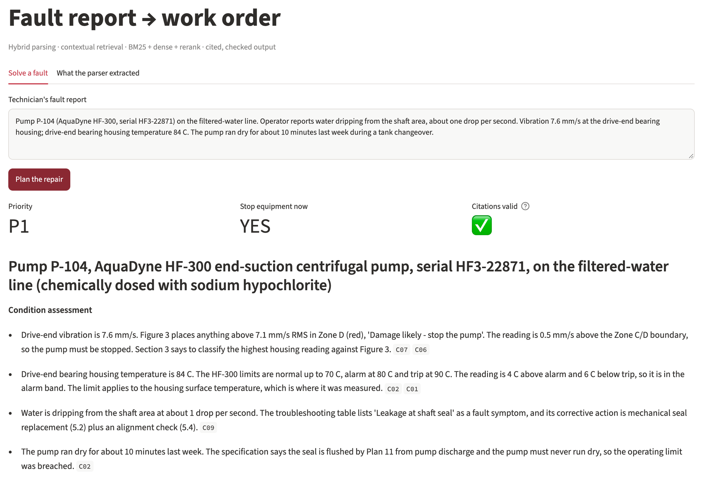
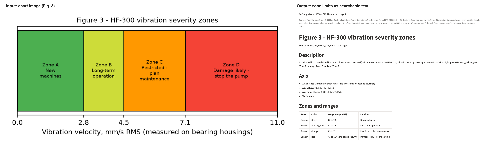

# Fault report → work order (RAG with Claude)

A technician reports a fault. The app reads the equipment manual, a scanned service bulletin and
the site's safety procedure, then produces a **structured work order**: condition vs. limits,
probable causes, ordered tasks with torques, part numbers, safety controls and labour, where
**every line cites the evidence** and the citations are checked in code.

RAG here solves a planning problem; it is not a chat box. The answer needs facts from three
documents, one of which overrides another.

## The sample problem

> Pump P-104 (AquaDyne HF-300, serial HF3-22871). Water dripping from the shaft, vibration
> 7.6 mm/s at the drive-end bearing, bearing housing 84 C, pump ran dry last week.

A correct work order has to:

| Fact | Where it lives | Why it's hard |
|---|---|---|
| 7.6 mm/s is Zone D → stop the pump | Chart in manual (Fig. 3) + site rule | Limits exist **only in the image** |
| 84 C is above the 80 C alarm → priority 1 | Spec table + site rule | Two documents |
| Seal is **HF3-450B**, not HF3-450 | Scanned bulletin overrides manual parts list | **No text layer**; sources conflict |
| Gland nut torque **30 Nm**, not 25 Nm | Scanned bulletin overrides manual Table 5 | Same conflict, serial-dependent |
| Lifting plan required | 68 kg assembly (manual) vs 25 kg limit (site) | Multi-hop across documents |
| Chemical goggles and gloves | P-104 is on a dosed line (site doc) | Only in a footnote sentence |

The documents are synthetic (generated by `make_sample_docs.py`), so there is no confidential or
copyrighted data. They are built to have ruled tables, an exploded-view drawing, a chart and
a skewed, noisy scan.

## Walkthrough (real run, Claude Opus 5.5)

### 1. The result: a prioritised, cited work order

The technician's free-text report goes in. The output says **P1, stop the pump now**, and every
reading is compared with its documented limit. The grey tags (`C07`, `C02`...) are the evidence
chunks behind each statement. The green tick means the code checked every citation (38 items,
0 unknown IDs, 0 uncited items).



### 2. Conflicting sources, resolved explicitly

The manual says seal **HF3-450** at **25 Nm**. A later scanned bulletin says serial HF3-22000 and
above must use **HF3-450B** at **30 Nm**. The planner checks the serial (HF3-22871), picks the
bulletin, and **shows its reasoning** under `source_conflicts`. The parts list follows from that
decision.


### 3. Ordered tasks with torques, plus site safety controls

Facts from three documents end up in one plan: the procedure and torques from the manual, the
30 Nm override from the bulletin, and the 68 kg lift and hypochlorite dosing from the site safety
procedure.


### 4. It says what it doesn't know

The model is told not to guess, so gaps in the evidence become open questions, for example
"was 7.6 mm/s measured as RMS?" or "which grease and how much?".


### 5. Under the hood: query decomposition and hybrid retrieval

Claude turns one report into 6–8 targeted queries. Each query runs BM25 + dense search, fused
with RRF and reranked by a cross-encoder. The numbers are reranker scores. Note that only the
serial-number query surfaces `C13`, the scanned bulletin.


### 6. Parsing what plain text extraction misses

**A scan with no text layer.** Claude vision transcribes it to Markdown, including the table.
Contextual retrieval then adds the grey "Context" line, so it can be found by meaning.


**A chart whose limits exist only as pixels.** Zone boundaries 2.8 / 4.5 / 7.1 mm/s are not in
the PDF's text. The figure is cropped and transcribed into a searchable table, which is how
"7.6 mm/s → Zone D → stop" becomes answerable.



The full CLI output of a run is in [`examples/sample_run.txt`](examples/sample_run.txt).

> **On determinism:** the CLI and UI runs above are two separate LLM runs. Both got the critical
> facts right, but wording and minor items differ between runs. For example, one run listed
> "chemical goggles and nitrile gloves" explicitly while another said "treat as a chemical
> hazard". This is exactly why the evaluation set below is the next step.

## Pipeline

```
INGEST (offline, once)                                 SOLVE (per fault report)
PDF ──► route each page element                        fault report
        ├─ digital text  → PyMuPDF blocks                  │
        ├─ ruled tables  → PyMuPDF table → Markdown        ▼
        ├─ figures       → crop → Claude vision        1. Claude decomposes it into 4–8 queries
        └─ scanned page  → Claude vision                   │  (structured output)
        ▼                                                  ▼
   structure-aware chunks (tables/figures never split)  2. each query: BM25 + dense → RRF
        ▼                                                  → cross-encoder rerank → merge
   contextual retrieval: Claude writes a context line      │
   per chunk (whole doc as cached prefix)                  ▼
        ▼                                              3. Claude writes WorkOrder (Pydantic
   BM25 index + bge-small embeddings                      schema), every item cites chunk IDs
                                                           ▼
                                                       4. code verifies every citation
```

## Techniques and why each one is here

1. **Hybrid, routed parsing** (`rag/parsing.py`). Each element goes to the cheapest reader that
   works. Digital text and ruled tables are extracted exactly and for free. Claude vision is used
   only where pixels carry the meaning: the chart, the drawing and the scan. Captions are attached
   to their table or figure, and reading order is kept. Sending every page to a VLM would cost more
   and risk misreading text that is already exact.
2. **Structure-aware chunking** (`rag/chunking.py`). Tables, figures and scans are atomic chunks.
   Half a torque table is how RAG quotes the wrong bolt.
3. **Contextual retrieval** (Anthropic, 2024). Before embedding, Claude writes one or two
   sentences situating each chunk in its document. A bare table row like "M10 | 25" becomes findable
   as "seal gland nut torque for the HF-300". The full document is sent as a cached prefix.
4. **Hybrid search with RRF, then reranking** (`rag/retrieval.py`). BM25 catches exact tokens
   such as `HF3-450B`, `M10` and `7.1`, which embeddings blur. Dense search catches paraphrase:
   "water dripping from the shaft" finds "leakage at shaft seal". Reciprocal Rank Fusion merges the
   two rankings without calibrating scores, and a cross-encoder reranks the fused candidates.
5. **Query decomposition** (`rag/workorder.py`). One fault report becomes several targeted
   lookups. This is what turns Q&A into problem solving.
6. **Grounded structured output with verification**. `messages.parse` with a Pydantic `WorkOrder`
   schema, a citation on every item, and a code-side check that every cited ID was actually supplied.
   Conflicts between sources must be resolved explicitly in `source_conflicts`.

Claude calls go through `rag/llm.py` (model `claude-opus-5-5`, adaptive thinking with an effort
level per step, and server-side refusal fallback enabled).

## Run it

```bash
export ANTHROPIC_API_KEY=...          # your key
uv sync
uv run python make_sample_docs.py     # writes docs/*.pdf (already included)
uv run python ingest.py               # parse, chunk, contextualise, embed → data/
uv run python solve.py                # CLI run on the sample fault
uv run streamlit run app.py           # UI: work order + every intermediate step
```

The first run downloads two small local models (embedder and reranker, about 200 MB in total).

## Files

| File | What it does |
|---|---|
| `rag/parsing.py` | Routed PDF parsing: text, tables, figures, scans |
| `rag/chunking.py` | Structure-aware chunks and contextual retrieval |
| `rag/retrieval.py` | BM25 + dense + RRF + rerank |
| `rag/workorder.py` | Decompose → retrieve → plan → verify citations |
| `rag/llm.py` | Every Claude call: text, structured output, images |
| `app.py` / `solve.py` | Streamlit UI / CLI |

## Not here yet (next steps)

- **Evaluation**: a golden set of fault reports with expected parts, torques and controls. Measure
  retrieval (recall@k per sub-query) and answer quality (RAGAS faithfulness, LLM-as-judge on the
  work order).
- **Agentic RAG**: let Claude decide when to search again, for example after spotting a serial-number
  dependency, instead of a fixed decompose-then-plan flow.
- **Page-image retrieval** (ColPali/ColQwen-style late interaction) for figure-heavy manuals.
- **Scale**: a vector DB instead of in-memory numpy, and Claude Haiku for the bulk ingest calls.
