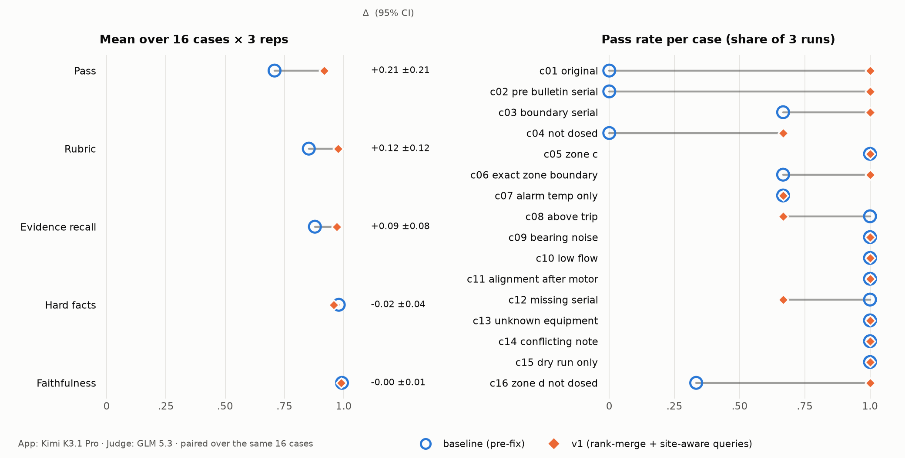

# Evaluation report: fault report → work order

*12 November 2026 · system: [`rag-workorder`](../README.md) · all numbers come from the files in
[`evals/results/`](results/) and [`evals/runs*/`](.)*

## 1. Summary

- **What was evaluated:** the full pipeline. A technician's fault report is decomposed into
  sub-queries, hybrid retrieval and reranking find evidence, and the model writes a structured,
  cited work order. Grading covers 16 hand-labelled cases × 3 runs per variant.
- **Baseline (Claude Opus 5.5):** pass **0.79**, pass^3 **0.62**. Hard facts such as the
  serial-dependent seal part and torque, priority and stop decision were nearly always right
  (0.96). Most failures were **missing site safety controls**.
- **Root cause, found through the evidence-recall metric and the traces:** the site procedure's
  controls table often never reached the planner. Sub-query results were merged by raw reranker
  score, which isn't comparable across queries, and every query was forced to name the pump
  model, so safety queries matched manual text instead.
- **Fix (v1), measured on the same models for both variants** (Kimi K3.1 Pro as the app, GLM 5.3
  as the judge): pass **0.71 → 0.92** (+0.21 ±0.21), pass^3 **0.53 → 0.73**, rubric +0.12
  ±0.12, evidence recall +0.09 ±0.08. Faithfulness was unchanged at 0.99.
- **Trade-off:** v1 produced more truncated outputs (8 of 57 attempts vs. 3 of 55), because Kimi's
  reasoning already uses about 14k of its 16k output tokens.
- **The eval also checked itself:** spot-checking failures found three grader bugs and one judge
  reliability issue. All were fixed or contained before any comparison, and every variant was
  re-graded with the same final grader.

## 2. System under test

| Stage | Implementation |
|---|---|
| Ingest (run once, not evaluated here) | Routed PDF parsing (vision for the chart and scan), structure-aware chunks, contextual-retrieval line per chunk. 3 documents → 16 chunks |
| Decompose | LLM writes 4–8 sub-queries (structured output) |
| Retrieve | Each sub-query: BM25 + bge-small dense → RRF → cross-encoder rerank, top 5. Merged to at most 14 evidence chunks |
| Plan | LLM fills a Pydantic `WorkOrder`; every item cites chunk IDs |
| Verify | Code checks every cited ID was supplied and every item cites something |

The runner calls the real entry point, `rag.workorder.solve()`. It doesn't rebuild the LLM calls
itself.

## 3. Evaluation design

### 3.1 Cases

16 fault reports ([`cases.md`](cases.md)). The ground truth was written by hand from the three
documents, never from model output, and was reviewed before any paid run.

| Category | Cases | What they test |
|---|---|---|
| Serial dependency | c01, c02, c03 | Bulletin overrides the manual (HF3-450B at 30 Nm) only for serial ≥ HF3-22000, including the exact boundary serial |
| Severity thresholds | c05–c08, c16 | Zone B/C/D, exactly 7.1 mm/s, 85 °C (alarm, so P1) vs 92 °C (trip, so stop) |
| Site-rule scope | c04, c16 | Chemical PPE only for the dosed pumps P-101 to P-106 |
| Other symptoms | c09–c11, c15 | Bearing noise, low flow, alignment after a motor swap, dry run |
| Robustness | c12–c14 | Missing serial, equipment the documents don't cover, a shift note contradicting the bulletin |

Gold evidence is identified by text snippets, which are resolved to chunk IDs at run time, so
re-running ingest doesn't invalidate the cases. All 16 cases and 22 retrieval probes resolve to
exactly one chunk each.

### 3.2 Graders and metrics

| Metric | Grader | Definition |
|---|---|---|
| **Pass** (headline) | combined | All hard facts correct **and** every rubric criterion met |
| Hard facts | code | Priority in the allowed set; stop decision; required/forbidden part numbers; the gland torque **applied** in tasks; required open question; citations valid. Fields the documents don't settle are not graded |
| Rubric | LLM judge | Share of 2–5 case-specific, checkable criteria met (e.g. "requires a lifting plan signed by the shift supervisor") |
| Faithfulness | LLM judge | Each work-order item judged *supported / partial / unsupported* against **only the chunks it cites** |
| Evidence recall | code | Share of gold evidence chunks that reached the planner |
| Citations | code | No unknown IDs, no uncited items |
| pass^3 | combined | Share of cases that pass on **all** 3 runs (consistency) |

The judge uses structured output, a system prompt that treats the work order as untrusted data
and tells it not to reward length, and validation that the number of verdicts matches the number
of criteria. **The judge is never the model under test** (Sonnet 5.5 judged Opus 5.5; GLM 5.3
judged Kimi K3.1 Pro).

### 3.3 Process and harness checks

- **Sign-offs before spending:** the user approved the case set, then the grading after reviewing
  pilot verdicts, then the budget.
- **Oracle and null checks:** a known-good work order passes the hard-fact checks. An empty one
  fails all of them. The known-good order graded against the wrong serial fails parts, priority
  and stop.
- **Failures are not zeros:** truncations, API errors and malformed judge verdicts go to
  `errors.jsonl` with a failure class. Only attempts that produced output are scored.
- **Served-model check:** an attempt fails if the API reports a different model from the one
  requested.
- **Resume and paired design:** rows are keyed by (case, rep). Variants are compared case by case
  with a 95% CI on the per-case difference.

## 4. Results

### 4.1 Retrieval ablation (local models only, no LLM calls)

22 targeted probe queries and 16 whole-report queries, each with gold chunks.

| Retriever | Chunk text | Probe recall@5 | Probe MRR | Whole report as one query, recall@5 |
|---|---|---|---|---|
| BM25 | with context | 1.00 | 0.91 | 0.51 |
| Dense | with context | 1.00 | 0.84 | 0.53 |
| Hybrid (RRF) | with context | 1.00 | 0.90 | 0.55 |
| **Hybrid + rerank** | **with context** | **1.00** | **0.97** | 0.41 |
| BM25 | raw chunk | 0.98 | 0.92 | 0.46 |
| Dense | raw chunk | 0.86 | 0.83 | 0.41 |
| Hybrid (RRF) | raw chunk | 0.98 | 0.88 | 0.49 |
| Hybrid + rerank | raw chunk | 0.98 | 0.86 | 0.34 |

- **Decomposition is the biggest lever.** Using the whole report as a single query finds only
  34–55% of the needed evidence; targeted sub-queries find 98–100%.
- **Contextual retrieval pays off.** Dense recall goes from 0.86 to 1.00, and rerank MRR from 0.86
  to 0.97.
- **The reranker helps short, targeted queries** (best MRR) **but not long ones** (worst
  whole-report recall).
- **Limitation:** probe recall saturates with only 16 chunks. Separating retrievers properly needs
  distractor documents.

### 4.2 Baseline: Claude Opus 5.5, Sonnet 5.5 judge

| Metric | Mean | 95% CI |
|---|---|---|
| **Pass** | **0.79** | ±0.14 |
| Hard facts | 0.96 | ±0.08 |
| Rubric | 0.90 | ±0.08 |
| Faithfulness | 0.92 | ±0.02 |
| Evidence recall | 0.92 | ±0.06 |
| Citations | 1.00 | ±0.00 |
| **pass^3** | **0.62** | (pass@3 = 1.00) |

All failures by case:

| Case | Pass | What failed |
|---|---|---|
| c01 original | 0.33 | LOTO / permit, signed lifting plan, goggles and gloves, notify reliability engineer |
| c02 pre-bulletin serial | 0.33 | Goggles and gloves, LOTO / permit |
| c03 boundary serial | 0.33 | Goggles and gloves |
| c04 not dosed | 0.67 | Signed lifting plan, LOTO / permit |
| c07 alarm temp only | 0.33 | Priority P2 instead of P1 (site rule: above alarm means P1) |
| c16 Zone D, not dosed | 0.67 | Notify reliability engineer before restart |
| other 10 cases | 1.00 | none |

**The serial-number logic was always right:** HF3-450B at 30 Nm for c01, c03 and c14; HF3-450 at
25 Nm for c02; an open question for the missing serial in c12; and the contradicting shift note
in c14 was rejected. **What failed was the site safety procedure.**

### 4.3 Root-cause analysis

The traces for the failing cases show that chunk **C15**, the site procedure's table of required
controls, wasn't in the evidence given to the planner. Replaying the baseline's own sub-queries
offline confirmed it: **C15 reached the planner in only 21 of 48 runs.** There were two causes.

1. **Merging by score across queries.** `gather_evidence` sorted every sub-query's hits by raw
   cross-encoder score and kept the top 14. Cross-encoder scores aren't calibrated across
   queries: a query that matches a manual table almost word for word scores far higher than a
   safety query's best hit, so manual chunks crowded out the site procedure.
2. **Every query was forced to name the equipment model.** The decomposition prompt said each
   query "includes the equipment model", so the safety query became *"AquaDyne HF-300 pump
   lockout/tagout isolation…"*, which matches manual text. Asked as a site question (*"Site safety
   procedure controls for seal work on pump P-108"*), C15 ranks **#1 with a score of 6.2, against
   −1.6** for the best manual chunk.

### 4.4 The fix (v1, [`runs/v1/change.md`](runs/v1/change.md))

- **Rank-merge:** take every sub-query's #1 hit, then every #2, and so on, round-robin, until the
  14-chunk budget is full.
- **Coverage-aware decomposition:** the prompt lists the facets a planner must cover (limits,
  causes, procedure, parts including serial-dependent changes, torques, labour, site safety), and
  site-rule queries are phrased about the site procedure and asset tag.

The offline replay showed that **rank-merge alone was a partial fix** (C15 reached the planner in
26/48 runs instead of 21/48, and overall recall stayed flat). The prompt change had to carry the
rest, and only a live run could show whether it did.

### 4.5 Before and after: paired, same models for both variants

The Claude account ran out of credits at the start of the v1 run (every attempt was rejected with
HTTP 400 and recorded, none scored). To keep the comparison fair, **both variants were re-run on
the same open-weight generator and judge** through Doubleword: Kimi K3.1 Pro as the app and GLM 5.3
as the judge. The baseline ran on the committed pre-fix code and v1 on the fix.

<picture>
  <source media="(prefers-color-scheme: dark)" srcset="results/before_after_dark.png">
  
</picture>

| Metric | baseline | v1 | Δ | 95% CI of Δ |
|---|---|---|---|---|
| **Pass** | 0.71 | **0.92** | **+0.21** | ±0.21 |
| Rubric | 0.85 | 0.98 | +0.12 | ±0.12 |
| Evidence recall | 0.88 | 0.97 | +0.09 | ±0.08 |
| Faithfulness | 0.99 | 0.99 | −0.00 | ±0.01 |
| Hard facts | 0.98 | 0.96 | −0.02 | ±0.04 |
| Citations | 1.00 | 0.98 | −0.02 | ±0.04 |
| **pass^3** (15 cases with all 3 runs in both variants) | 0.53 | **0.73** | | |

**How to read it:**

- **The wins are exactly where the diagnosis predicted:** the cases that need site safety
  controls. c01 and c02 go from 0.00 to 1.00, c04 from 0.00 to 0.67, c16 from 0.33 to 1.00, and
  c03 and c06 from 0.67 to 1.00.
- **The open-weight baseline shows the same failure mode as Claude** (c01, c02, c04 failing on
  LOTO, the lifting plan and PPE). The bug is in the retrieval pipeline, not specific to one model.
- **Rubric and evidence-recall gains are statistically clear.** The pass-rate CI just touches
  zero at n=16, so more cases would tighten it.

### 4.6 Failure analysis

| Variant | Graded runs | Truncated (app) | Malformed judge verdict | Notes |
|---|---|---|---|---|
| Claude baseline | 48 | 0 | 0 | none |
| DW baseline | 47 | 3 (all c15) | 5 (GLM skipped criteria) | c15 hit the output limit in 3 of its 5 attempts |
| DW v1 | 48 | 8 | 1 (judge hit its own limit) | spread over 7 cases |

- **Truncation is a token-budget problem, not a quality problem.** Kimi K3.1 Pro's median output
  is **13.6k (baseline) and 15.0k (v1) tokens, against a 16k cap**, most of it reasoning. v1's
  broader decomposition adds about 1.4k. Next step: a higher output budget, or a reasoning-effort
  setting for the planner. Truncated attempts are reported, never scored, and retried once per
  variant.
- **The two v1 regressions are explained:**
  - c08 rep 1 cited `"15"` instead of `"C15"`. That's a real (minor) app error, and the citation
    check caught it.
  - c12 rep 2 is a **judge error**: GLM's reason says *"both seal parts appear strictly as
    conditional line items"* (criterion met), but its verdict says `met=false`.
- **c07 fails in every variant** (Claude and both Kimi runs): 85 °C is above the 80 °C alarm, so
  the site rule requires P1, but the model sometimes assigns P2. That's the next prompt or rubric
  target.

## 5. Bugs found in the eval itself

Every failure was read before any comparison was made. Grader fixes were re-applied to **every**
variant with `--regrade`, which recomputes grades from saved traces without calling any model.

| Bug | How it was found | Fix |
|---|---|---|
| Torque check accepted "30 Nm, **not** 25 Nm" as 25 | Oracle test: the c01 work order graded as c02 still passed `torque_ok` | Only torques in `tasks` count; negated or superseded values are ignored |
| Torque check picked up the 85 Nm bearing-bolt torque and missed long-range negation | Spot-check of c02 failures in the Doubleword run | Stop at the next fastener, semicolon or hyphenated "bearing-housing"; allow a 5-word negation window. Unit-tested on 7 real model sentences |
| "Forbidden seal part" failed work orders that listed the seal as a contingency spare (c10, c11) | Spot-check of Claude baseline failures | Check removed from c10 and c11; the judge criterion "does not order a seal replacement" covers the intent (case-set revision 2) |
| GLM 5.3 sometimes returned verdicts for only some criteria | Verdict-count validation | Up to 3 retries, then `grader_error` (never scored) |

**Judge accuracy:** in the Claude pilot, all 10 rubric verdicts were checked by hand and all were
correct. With GLM 5.3, one self-contradicting verdict (c12) was found among the failures. The judge
hasn't been formally calibrated against a human-labelled sample (see §8).

## 6. Cost and latency (measured from API `usage`)

| Run | App model | Judge | Graded runs | App $/run | Judge $/run | Total | Median latency | Median output tokens |
|---|---|---|---|---|---|---|---|---|
| Claude pilot | Opus 5.5 | Sonnet 5.5 | 3 | 0.128 | 0.082 | $0.63 | 82 s | n/a |
| Claude baseline | Opus 5.5 | Sonnet 5.5 | 48 | 0.114 | 0.070 | $8.81 | 59 s | 4.5k |
| DW baseline | Kimi K3.1 Pro | GLM 5.3 | 47 | 0.138 | 0.088 | $10.62 | 159 s | 13.6k |
| DW v1 | Kimi K3.1 Pro | GLM 5.3 | 48 | 0.155 | 0.102 | $12.34 | 152 s | 15.0k |

Total spend was about **$32**. Kimi costs about the same per run as Opus here: it's cheaper per
token but produces about 3× the output tokens, and it is about 2.6× slower.

## 7. Threats to validity

- **Small, synthetic corpus.** 3 documents and 16 chunks, built to contain known traps. The
  retrieval ablation saturates, and the results show the pipeline handles *these* traps, not
  real-world manuals at scale.
- **n = 16 cases.** CIs are wide, and the pass-rate improvement is borderline at 95%.
- **The fix was measured on Kimi, not Claude.** The Claude baseline shows the same failure mode, so
  the fix should transfer, but Claude v1 was not run (no credits).
- **The judges are LLMs.** They weren't calibrated against human labels; one GLM verdict was
  self-contradicting. Rubric criteria were kept concrete and checkable to limit this.
- **The case set was revised once, after the baseline** (c10 and c11 forbidden-part checks
  removed). The revision was applied to every variant, so comparisons stay consistent.
- **Truncated attempts are excluded from scores and retried once.** That favours a variant that
  truncates more if its truncated attempts would have failed. v1 truncated more, so its scores
  may be slightly optimistic.

## 8. Next steps

1. **Raise the planner's output budget** (or lower reasoning effort) to remove truncation, then
   re-measure.
2. **Calibrate the judge:** label about 40 verdicts by hand, report agreement, and consider a
   2-judge jury for disagreements.
3. **Harder retrieval set:** add distractor manuals (a second pump model, an older revision) so
   the ablation separates the retrievers.
4. **Grow the case set** to around 50 cases with a random held-out split before any further prompt
   tuning.
5. **Fix c07:** make the site priority rule explicit in the planning prompt, then confirm on the
   held-out split.

## 9. Reproduce

```bash
uv run python evals/retrieval_ablation.py                                   # free
uv run python evals/run_eval.py --variant baseline --reps 3                 # Claude (default models)
export APP_MODEL=moonshotai/Kimi-K3.1-Pro JUDGE_MODEL=zai-org/GLM-5.3       # DOUBLEWORD_API_KEY in .env
uv run python evals/run_eval.py --runs-dir runs_doubleword --variant v1 --reps 3
uv run python evals/run_eval.py --runs-dir runs_doubleword --compare baseline v1
uv run python evals/run_eval.py --runs-dir runs_doubleword --variant v1 --regrade   # after a grader fix
uv run python evals/plot_report.py                                          # the chart above
```

| File | Contents |
|---|---|
| [`cases.json`](cases.json) / [`cases.md`](cases.md) | Cases, expected values, rubrics, gold evidence |
| [`graders.py`](graders.py) | Code checks and LLM judge |
| [`run_eval.py`](run_eval.py) | Runner, summary, regrade, paired comparison |
| [`retrieval_ablation.py`](retrieval_ablation.py) | Retriever × context ablation |
| [`results/`](results/) | Summaries, comparison, ablation, chart |
| `runs/`, `runs_doubleword/` | Per-run `results.jsonl`, `errors.jsonl` and full traces |
